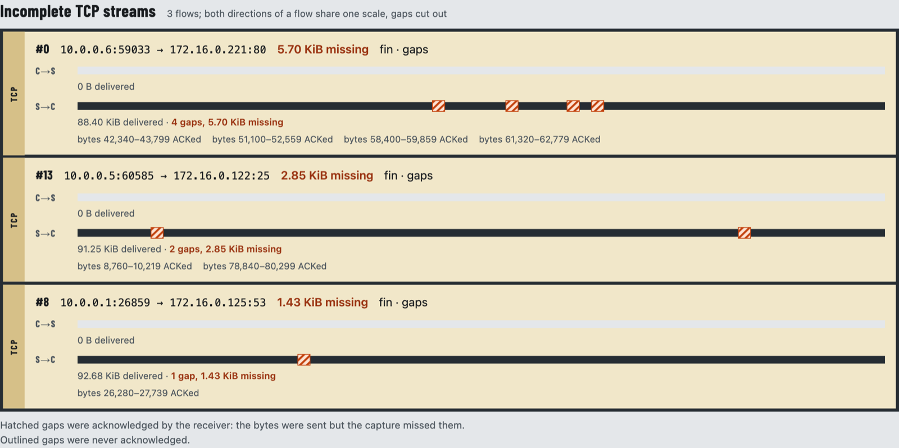
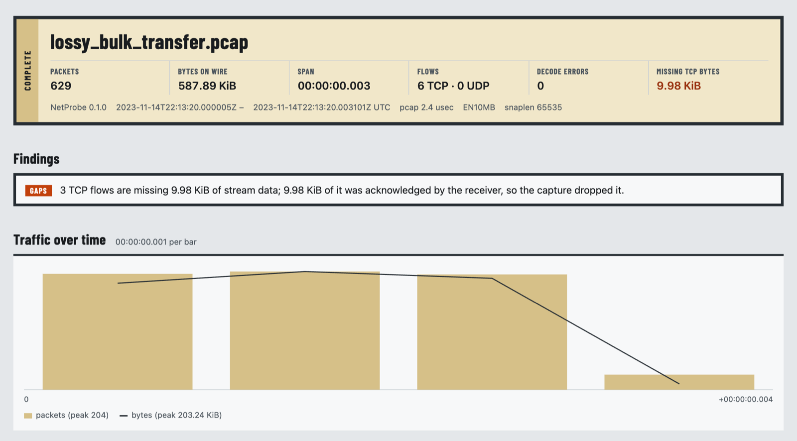
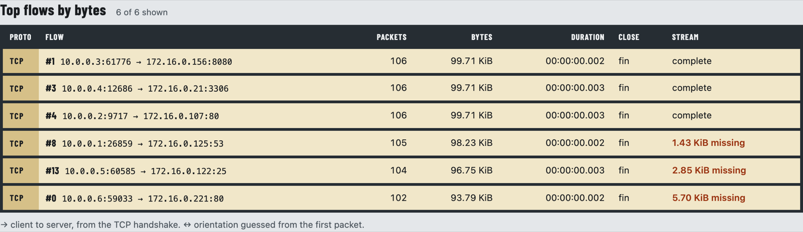

# NetProbe

[](https://github.com/Eliot-2006/netprobe/actions/workflows/ci.yml)

A high-performance offline network packet analyzer in C++20. NetProbe reads classic PCAP captures,
decodes Ethernet, VLAN, IPv4, IPv6, TCP and UDP with bounds-checked zero-copy parsing, reassembles
TCP byte streams, and reports exactly which bytes of which stream are missing and whether the
receiver acknowledged them. Output is a terminal summary, deterministic JSON, and a self-contained
HTML report.

The packet parsing and TCP reassembly are implemented from scratch. Nothing wraps Wireshark or
libpcap.



*Part of the HTML report for `samples/lossy_bulk_transfer.pcap`. Each TCP direction is drawn to
scale. Hatched blocks are byte ranges the receiver acknowledged but the capture never recorded,
listed exactly underneath.*

**Live sample reports:** [lossy bulk transfer](https://eliot-2006.github.io/netprobe/demo/lossy_bulk_transfer.html) ·
[mixed traffic](https://eliot-2006.github.io/netprobe/demo/mixed_traffic.html) ·
[clean HTTP session](https://eliot-2006.github.io/netprobe/demo/http_session.html)

## Highlights

- **TCP reassembly that holds up on hostile input.** 32-bit sequence numbers are unwrapped into
  64-bit stream offsets in one function, so wraparound cannot leak into the buffer logic.
  Out-of-order data sits in a disjoint interval map. When copies overlap, the first one wins and
  byte-level conflicts are counted. In-order segments are delivered straight from the
  memory-mapped file without copying.
- **Bounded memory by construction.** Every buffered segment is charged to a per-stream limit
  and a per-shard budget, overhead included, so floods of tiny segments cannot get around the
  limits. A 100,000-SYN flood is held at the flow limit. A release frontier returns processed
  file pages to the OS: peak RSS on a 1 GiB capture is 33–78 MiB on Linux.
- **Parallel without changing the answer.** `--workers N` shards flows across threads through
  lock-free single-producer/single-consumer rings. A fixed pool of batches doubles as
  backpressure. Reports are byte-identical for any worker count, and a test checks that on every
  run.
- **Correctness checked against independent sources:**
  - 21 Scapy-built captures with expected results recorded when they were generated.
  - A deliberately naive reference reassembler checked on randomized segment schedules.
  - Per-packet, per-conversation and per-stream comparison with `tshark`.
  - Identical output across worker counts.
  - 787 public real-world captures checked under ASan and against `tshark`, with the four bugs
    found fixed: [`docs/validation.md`](docs/validation.md).
- **Hardened and measured.**
  - CI runs ASan+UBSan and TSan with GCC 13 and Clang 18.
  - Three libFuzzer targets, 30 minutes each: 1.87 billion executions, 0 findings.
  - Every benchmark number in [`docs/results.md`](docs/results.md) comes with the command that
    produced it.

## Results

Linux (Ubuntu 24.04 container on an Apple M3 Pro, arm64; no x86-64 machine was available), GCC 13
`-O2`, page cache warm, 1 GiB synthetic captures, median of 5. Throughput is from a quiet-host run;
the final code was re-checked at 1 GiB and 2 GiB with no slowdown. Full methodology in
[`docs/results.md`](docs/results.md).

| Measure | Result |
|---|---|
| Packet decoding (single core) | 38.6 M packets/s |
| End to end, single-threaded | 3.73 M packets/s (1.77 GiB/s) |
| End to end, 4 workers | 7.69 M packets/s (2.06×) |
| TCP reassembly with 10 % reordering | 31.4 GiB/s |
| Peak memory, bulk-transfer capture (1 GiB and 2 GiB) | 33–78 MiB |
| Memory per live flow | ≈ 490 B (target 512 B) |

Scaling stops near 2× because the single reader thread is about 47 % of the per-packet cost, which
is the Amdahl ceiling the measurements match. A single elephant flow cannot be split across
threads.

## Try it

Requires CMake 3.25+, Ninja and GCC 13+ or Clang 17+ (macOS: Homebrew LLVM, see
[Platform notes](#platform-notes)).

```bash
scripts/demo.sh        # builds, analyzes the three sample captures, writes out/demo/*.html|json
```

Or run it on any classic PCAP file:

```bash
cmake --preset release && cmake --build --preset release --target netprobe
build/release/netprobe analyze capture.pcap --html report.html --json report.json
```

Terminal output for `samples/lossy_bulk_transfer.pcap`:

```
netprobe 0.1.0  samples/lossy_bulk_transfer.pcap  (pcap 2.4, usec, EN10MB, snaplen 65535)
  629 packets  587.89 KiB  span 00:00:00.003  status: complete
  IPv4 629  IPv6 0  VLAN 0  TCP 629  UDP 0  ICMP 0  ARP 0  fragments 0
  decode errors: none
  flows: 6 TCP (6 full handshake, 3 complete), 0 UDP; 3 TCP flows with gaps (9.98 KiB missing)
  reassembly: 554.63 KiB delivered, 0 B retransmitted, 154 out-of-order segments, 0 conflicting overlap bytes
  top flows:
    #1        10.0.0.3:61776 -> 172.16.0.156:8080  tcp  99.71 KiB  fin  complete
    #3        10.0.0.4:12686 -> 172.16.0.21:3306  tcp  99.71 KiB  fin  complete
    #4        10.0.0.2:9717 -> 172.16.0.107:80  tcp  99.71 KiB  fin  complete
    #8        10.0.0.1:26859 -> 172.16.0.125:53  tcp  98.23 KiB  fin  gaps
    #13       10.0.0.5:60585 -> 172.16.0.122:25  tcp  96.75 KiB  fin  gaps
    #0        10.0.0.6:59033 -> 172.16.0.221:80  tcp  93.79 KiB  fin  gaps
```

The HTML report is a single offline file (inline CSS and SVG, no scripts) that leads with
capture integrity and findings:





## How it works

```
capture.pcap ─mmap─► PcapReader ─► decode_packet ─► ReaderStats
  (zero-copy views)                     │
                          ┌─────────────┴─────────────┐
                    --workers 0                 --workers N
                  Analyzer (inline)     hash(flow) ─► SPSC ring ─► Analyzer shard × N
                          └─────────────┬─────────────┘
                                 merge (deterministic)
                                        ▼
                         text summary · JSON · HTML · stream files
```

Each `Analyzer` shard owns its flow table, TCP state, reassemblers and memory budget, with no
shared state. [`docs/design.md`](docs/design.md) covers the ownership invariants, the reassembly
algorithm, the concurrency design and why the determinism guarantee holds.
[`docs/PRD.md`](docs/PRD.md) has the original requirements and a log of the decisions that changed
during implementation.

## Usage

```
netprobe analyze <capture.pcap> [options]
netprobe dump <capture.pcap> [--limit N]      # one TSV line per decoded packet
netprobe --help | --version
```

| Option | Meaning |
|---|---|
| `-o, --json <path>` | JSON report; `-` writes to stdout and implies `--quiet` |
| `--html <path>` | standalone HTML report |
| `--export-streams <dir>` | write each reassembled TCP direction to a file |
| `-q, --quiet` | suppress the text summary |
| `--deterministic` | omit timings, host and worker count so output is reproducible |
| `-j, --workers <N>` | 0 = single-threaded (default); N ≥ 1 = reader plus N shards (max 256) |
| `--idle-timeout <sec>` | open-flow idle timeout in capture time (default 300) |
| `--max-flows <N>` | max concurrent flows (default 1,000,000) |
| `--max-stream-buffer <size>` | out-of-order buffer per TCP direction (default 4M) |
| `--max-reassembly-memory <size>` | total out-of-order budget (default 512M) |
| `--top-flows <N>` | detailed flow records per list (default 1000, max 100,000) |

Sizes accept `K`, `M`, `G` (powers of 1024). Exit codes: 0 success; 1 usage error; 2 unreadable or
unsupported input; 3 report written but the capture is truncated or corrupt; 4 output or internal
error.

## Testing

```bash
cmake --preset dev  && cmake --build --preset dev  && ctest --preset dev    # debug + hardened STL
cmake --preset asan && cmake --build --preset asan && ctest --preset asan   # ASan + UBSan
cmake --preset tsan && cmake --build --preset tsan && ctest --preset tsan   # ThreadSanitizer
cmake --preset fuzz && cmake --build --preset fuzz                          # build/fuzz/fuzz_*
```

The suite covers 156 tests: GoogleTest unit, property and pipeline tests, plus Python integration
tests run by CTest (ground truth, golden files, determinism, HTML safety). CI also runs a fuzz smoke
test, the `tshark` differential and clang-format. The verification strategy is described in
[`docs/design.md`](docs/design.md#9-verification-strategy).

## Scope and limitations

- Offline classic PCAP with the Ethernet link type. No live capture, no pcapng (it suggests
  `editcap -F pcap`), no stdin input.
- IP fragments are counted, not reassembled. No application-layer dissectors; service names are
  guesses from port numbers. TCP/UDP checksums are not verified.
- VLAN IDs are not part of the flow key. Determinism across worker counts assumes non-decreasing
  capture timestamps and no memory limit being hit (the report says when one was).
- Scaling is capped by the reader thread (see Results).
- Not measured on x86-64 hardware. The bundled sample captures are synthetic; real-world captures
  are fetched by `scripts/fetch_realworld.sh`, not committed.

## Platform notes

- **Linux** is the primary target; CI uses Ubuntu 24.04 with GCC 13 and Clang 18.
- **macOS** needs Homebrew LLVM (`brew install llvm`,
  `export CXX=/opt/homebrew/opt/llvm/bin/clang++`). Apple Clang 15 lacks `std::format` and
  libFuzzer. `scripts/demo.sh` picks LLVM automatically. Run the `asan` preset on Linux: under ASan on
  macOS, tests that throw exceptions abort (Homebrew's libc++abi conflicts with ASan's interception).
  `MADV_DONTNEED` does not reduce resident memory on macOS, so the release frontier only bounds RSS
  on Linux.
- **Linux from macOS:** `tools/docker/Dockerfile` builds the Ubuntu 24.04 image used for sanitizers,
  fuzzing, the `tshark` differential and benchmarks:
  `docker build -t netprobe-dev:24.04 tools/docker`, then
  `docker run --rm -v "$PWD":/src -w /src netprobe-dev:24.04 bench/run_linux_container.sh`.

## Repository layout

| Path | Contents |
|---|---|
| `src/` | `io/` mmap · `pcap/` reader · `decode/` · `flow/` · `tcp/` sequence math and reassembler · `analysis/` analyzer, stats, memory budget · `pipeline/` · `report/` JSON, HTML, text |
| `tests/` | `unit/` GoogleTest · `integration/` Python via CTest · `fixtures/` Scapy captures and ground truth · `golden/` · `reference/` naive reassembler · `differential/` tshark · `fuzz/` |
| `bench/`, `tools/` | Google Benchmark suites, end-to-end harness, `synth_pcap` dataset generator, Docker image |
| `samples/`, `scripts/` | three synthetic demo captures, `demo.sh` |
| `docs/` | [`PRD.md`](docs/PRD.md) requirements · [`design.md`](docs/design.md) architecture · [`results.md`](docs/results.md) benchmarks · [`validation.md`](docs/validation.md) real-world captures |
| `DESIGN.md` | visual design system of the HTML report |
